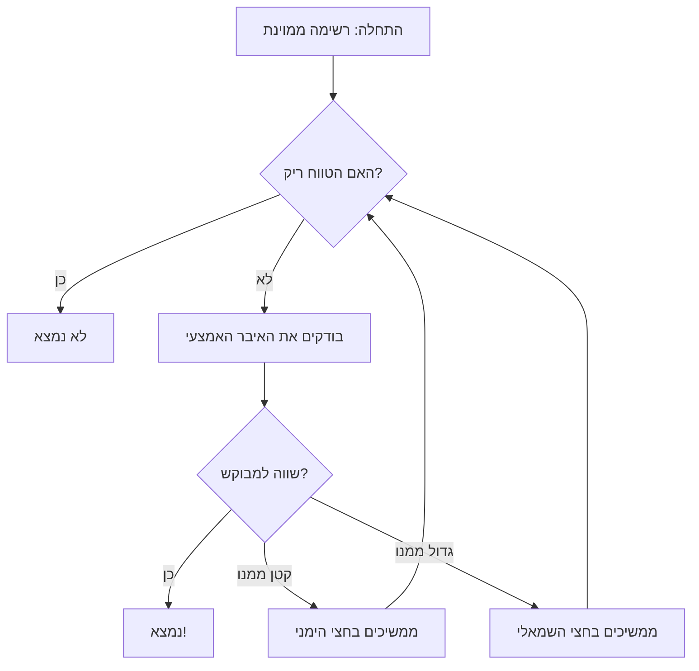
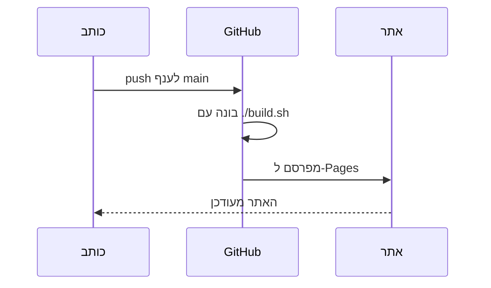

## נוסחה בתוך משפט

נוסחה בין סימני דולר, `$...$`, נכתבת בתוך השורה. היא תמיד משמאל לימין ומבודדת מהמשפט, ולכן הסוגריים במקום: זמן הריצה של חיפוש בינארי הוא $O(\log n)$, ושל מיון מיזוג הוא $O(n \log n)$. פונקציה $f(x) = x^2 + 1$ בתחילת משפט, או קבוצה $\{1, 2, 3\}$ בסופו, נשארות תקינות.

## נוסחת בלוק

נוסחה בין `$$...$$` עומדת בשורה משלה, במרכז:

$$
T(n) = 2\,T\!\left(\frac{n}{2}\right) + \Theta(n) \quad\Longrightarrow\quad T(n) = \Theta(n \log n)
$$

נוסחת נסיגה עם מקרים:

$$
F(n) = \begin{cases} 0 & n = 0 \\ 1 & n = 1 \\ F(n-1) + F(n-2) & n > 1 \end{cases}
$$

> [!tip] עברית בתוך נוסחה
> טקסט בתוך `\text{...}` מסדר את עצמו לפי התוכן: $\text{זמן ריצה} = O(n)$.

## תרשימים

תרשים Mermaid נכתב בבלוק קוד מסוג `mermaid`. התוויות בעברית מוצגות מימין לשמאל:

תרשים רצף:

