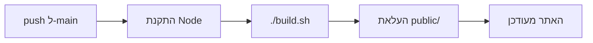

הריפו מגיע עם תהליך GitHub Actions, `.github/workflows/deploy.yml`, שבונה את האתר ומפרסם אותו ב-GitHub Pages בכל push לענף `main`.

## הפעלה, פעם אחת

1. מעלים את הריפו ל-GitHub.
2. ב-**Settings ← Pages**, תחת **Build and deployment**, בוחרים ב-**Source** את **GitHub Actions**.
3. ב-`quartz.config.yaml` מעדכנים את `baseUrl` לכתובת האמיתית: `<משתמש>.github.io/<שם-הריפו>`.
4. ב-`quartz.ts` מעדכנים את `repository` ל-`<משתמש>/<שם-הריפו>`.

מעכשיו, כל push ל-`main` מעדכן את האתר תוך דקה או שתיים. ההתקדמות נראית בלשונית **Actions**.

> [!info] דומיין משלכם
> כדי לפרסם בכתובת כמו `docs.example.co.il`, מוסיפים אותה ב-**Settings ← Pages ← Custom domain**, מפעילים את התוסף `@quartz-community/cname` ב-`quartz.config.yaml`, ומעדכנים את `baseUrl`.

## מה התהליך עושה

`build.sh` מתקין את Quartz בגרסה שב-`quartz-version.txt`, מרכיב את התבנית, ובונה את האתר לתיקייה `public/`. אותו סקריפט רץ גם על המחשב שלכם, כך שמה שרואים ב-`./dev.sh` הוא מה שיתפרסם.
