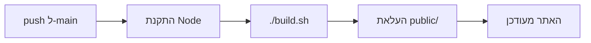

כל ריפו (הבסיס וכל קורס) מגיע עם תהליך GitHub Actions קצר, `.github/workflows/deploy.yml`, שבכל push לענף `main` קורא לתהליך המשותף `build-course.yml` של הבסיס. הוא בונה את האתר ומפרסם אותו ב-GitHub Pages.

## הפעלה, פעם אחת

1. מעלים את הריפו ל-GitHub.
2. ב-**Settings ← Pages**, תחת **Build and deployment**, בוחרים ב-**Source** את **GitHub Actions**.
3. ב-`course.ts` מוודאים ש-`repository` הוא `<משתמש>/<שם-הריפו>` ו-`baseUrl` הוא `<משתמש>.github.io/<שם-הריפו>` (`scripts/new-course.sh` כבר ממלא את שניהם).

מעכשיו, כל push ל-`main` מעדכן את האתר תוך דקה או שתיים. ההתקדמות נראית בלשונית **Actions**.

> [!info] דומיין משלכם
> כדי לפרסם בכתובת כמו `docs.example.co.il`, מוסיפים אותה ב-**Settings ← Pages ← Custom domain**, מפעילים את התוסף `@quartz-community/cname` ב-`overrides/config.yaml` של הקורס, ומעדכנים את `baseUrl` ב-`course.ts`.

## מה התהליך עושה

`build.sh` מתקין את Quartz בגרסה שב-`quartz-version.txt`, מרכיב את התבנית, ובונה את האתר לתיקייה `public/`. אותו סקריפט רץ גם על המחשב שלכם, כך שמה שרואים ב-`./dev.sh` הוא מה שיתפרסם.
